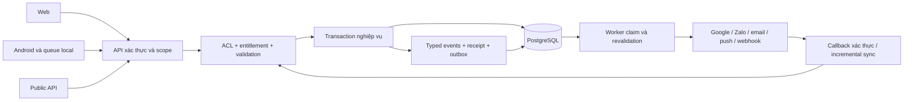

# Kiến trúc, dữ liệu và độ tin cậy

Ngày cập nhật: **2026-10-16**. Tài liệu phân biệt **baseline kiểm tra từ repo** với **thiết kế mục tiêu chưa triển khai**. Đây không phải migration đã chạy hoặc cam kết rằng test mới đã đạt.

Liên quan: [quyết định](02-baseline-and-decisions.md), [nghiệp vụ](03-functional-spec.md), [tích hợp](04-integrations.md), [tasks](07-tasks.md), [waves](08-waves.md), [test nền tảng](test-cases/01-foundation.md) và [test offline](test-cases/03-offline-imports-integrations.md).

## 1. Baseline kỹ thuật đã kiểm tra

| Thành phần | Hiện trạng từ mã nguồn | Hệ quả cho triển khai |
|---|---|---|
| Web/runtime | Root package yêu cầu Node ≥24; Next `^16.3.8`, React 19; business modules dưới `server/` | Giữ hệ thống hiện tại; đọc tài liệu Next đã cài theo AGENTS trước sửa code |
| Android | Expo `~57.0.26`, React Native `0.86.3`, Expo Router, React Query, expo-sqlite, SecureStore | Đọc tài liệu Expo 57 trước thay API; SQLCipher cần xác minh build native, không coi đã bật |
| Server database | PostgreSQL qua `pg`, adapter `server/db.mjs` và worker đồng bộ; production không phải SQLite | Test schema/concurrency bằng PostgreSQL thật riêng biệt |
| Migration | `SCHEMA_VERSION = 2`, migrations 001-baseline và 002-reminder-source; advisory transaction lock khi migrate | Thêm migration mới tuần tự, không sửa migration đã áp dụng |
| Transaction | `withTransaction` dùng callback đồng bộ; reject callback trả Promise | Không await provider/network bên trong transaction; tách outbox |
| Revision | Hash một tập persisted fields của task/event/service; `expectedRevision` đang tùy chọn | Chưa đủ aggregate child revision và durable operation receipt của roadmap |
| Task access | Scope chính hiện dựa workspace/team | Guest/private project cần đổi toàn bộ đường truy cập, không chỉ picker/UI |
| Notification | Đã có email/FCM/Web Push và các bảng outbox/delivery, revalidation; có test serialization worker | Tái sử dụng và củng cố claim/lease/dedup; không viết lại kênh từ đầu |
| Android offline | TTL đọc 24h, scope origin/user/workspace; `isWritable` hiện yêu cầu online | Offline create/edit và durable queue là phần mới |
| Backup | Snapshot PostgreSQL có bảng/cột/schemaVersion, validation; export repeatable-read, import vào target rỗng trừ chế độ replace tường minh | Bổ sung bảng mới vào manifest, đường nâng snapshot cũ và recovery; không phá restore |

Các đường nguồn kiểm chứng: `server/db.mjs`, `server/database-snapshot.mjs`, `server/database-tables.mjs`, `server/record-revision.mjs`, `server/mobile.mjs`, `mobile/src/core/policy.ts`, package manifests. Không suy từ tài liệu kế hoạch cũ rằng chức năng đã hoặc chưa triển khai.

## 2. Cấu trúc mục tiêu

Giữ modular monolith với Web/Android/API dùng chung business services và PostgreSQL. Tiếp tục mô hình triển khai một worker chủ động; claim/lease vẫn bắt buộc để chịu restart hoặc chồng tiến trình khi deploy. Không thêm message broker, microservice, event-sourcing framework hoặc ORM chỉ để thực hiện roadmap.

Phân tách cần thiết là ranh giới nghiệp vụ, không phải nhiều tầng trừu tượng: authorization dùng chung; mutation dùng chung; serialization allowlist theo principal; transport/provider adapter riêng; UI không tự quyết quyền cuối cùng.

## 3. Mô hình dữ liệu logic

Tên dưới đây mô tả thực thể cần có, không khẳng định bảng đã tồn tại. Khi triển khai, tái sử dụng bảng phù hợp; mọi thay đổi đồng bộ schema, migration, mapping backup, API types và tests.

| Thực thể | Dữ liệu tối thiểu và ràng buộc |
|---|---|
| Project | ID, workspace, tên, access mode workspace/team/private, team nếu kế thừa, archived/deleted metadata; không đổi scope khi thiếu projectId từ client cũ |
| Project board/column | Một board/project; column giữ ID riêng, thứ tự và lifecycle todo/doing/done; tên trùng không đồng nghĩa cùng cột |
| Project membership | Project, user, role viewer/commenter/editor/manager và nguồn membership; guest không được manager; unique theo project/user |
| Workspace membership/invitation | Member/guest classification, trạng thái active/pending, expiry; invitation giữ ghế theo danh tính hợp lệ; một user một ghế/workspace |
| Task | Project ID bắt buộc sau backfill, lifecycle, column, title/description, dueAt/shared start, priority, recurrence/anchor, primary/collaborator relations, aggregate revision và soft delete |
| Personal plan | Task/user, planned date/time/duration và revision độc lập; unique task/user; không biến kế hoạch thành deadline |
| Checklist/labels/collaborators | Quan hệ scope theo task/project; child mutation làm đổi aggregate task revision; không dùng tên hiển thị làm khóa |
| Custom field definition/value | Project, stable field ID, type/options/order/retired; typed values theo task; option thuộc đúng field/project |
| Dependency | Project, predecessor/successor, finish-to-start; unique edge, khác task, DAG; advisory blocking |
| Saved view/template | Owner/project, visibility, config có version; template giữ cấu trúc/relative dates nhưng không sao chép raw membership hoặc credential |
| Business event | Stable ID, workspace/project/resource, type, actor/source, occurredAt server, before/after hoặc snapshot cần thiết, assignment cycle, operation/causation ID |
| Mutation receipt | Workspace/principal/operation ID, resource/action, canonical payload hash, response identity/revision và commit metadata; unique operation trong scope |
| Outbox job/attempt | Event/source/cycle/recipient/channel, dedupe key, trạng thái, claim/lease, attempt count, nextAttemptAt, lỗi redacted, provider correlation; attempts tách logical job |
| Service renewal | Service/cycle/anchor/actor/operation, history, renewal task nếu được cấu hình và optional expense reference; unique operation/kỳ để không nhân giao dịch |
| Work calendar/delegate | Working windows, timezone, holidays và hiệu lực; delegation chỉ chọn user đã có ACL, không tự tạo membership |
| Time entry/timer | Workspace/task/user, started/stopped/duration, nguồn manual/timer; tối đa một timer active/user/workspace |
| Assignee estimate | Task/user/estimate, đơn vị rõ; null = chưa ước lượng, không chia đều tổng task |
| Integration connection | Workspace/user/provider/OA identity, status, encrypted credential/key version, consent/scopes, last success/error |
| Google mapping/sync state | Connection/type/local resource, Google calendar/event ID, ETag/base revision/snapshot, sync token, channel expiry, conflict và persistent suppression |
| Import source/receipt | Source provider/board/card, project, destination ID và batch operation; JSON v1 append giữ riêng |
| API credential/webhook | Hash token, creator/scopes/project filter/revocation; subscription, versioned signing key, event/delivery IDs và attempts |

Tenant boundary phải được biểu diễn bằng constraint/query, không chỉ từ caller: mọi lookup/join có workspace và project thích hợp; foreign relations không được tham chiếu task/user/customer khác tenant. Thêm FK/unique/check constraints khi biểu diễn được; graph cycle vẫn cần kiểm tra nguyên tử trong transaction.

Index tối thiểu phục vụ các truy vấn thực: task theo workspace/project/deleted/lifecycle/due và sort ID; membership theo user/project; outbox theo trạng thái/nextAttempt; event theo resource/time; receipt theo scope/operation; mapping theo connection/event và connection/local/type; invitation theo workspace/status/expiry. Xác minh bằng query plan và fixture lớn trước thêm index trùng.

## 4. Authorization và entitlement

### 4.1 Quyền dự án

Ba access mode: kế thừa workspace, kế thừa team và private. Owner/admin workspace luôn có quyền truy cập private theo quyết định sản phẩm; SaaS admin không tự có quyền đọc nghiệp vụ. Guest chỉ truy cập project được mời, theo viewer/commenter/editor; không được quản lý member/integration/billing, đọc CRM/tài chính/dịch vụ/danh bạ toàn workspace, xóa task hoặc move qua project.

Authorization dùng cùng predicate cho list/detail/mutation/search/AI/export/trash/report/count/file download/notification/worker. Không để bộ lọc UI che endpoint rộng quyền. Mọi metadata như assignee picker, tên customer, tổng task, notification history cũng qua scope; liên kết task tới CRM không tự cấp quyền CRM.

Copy/move/restore kiểm tra nguồn, đích, assignee, custom field và dependency. Move không để cạnh khác project hoặc gán người ngoài project đích. Queue projection có context cũ phải bị vô hiệu/revalidate; receipt replay không trả dữ liệu ngoài quyền mới.

### 4.2 Entitlement

Backend dùng mã capability ổn định, không đoán quyền từ tên hiển thị hoặc giá gói. Session có thể trả capabilities để UI trình bày, nhưng mỗi mutation/sender kiểm lại trạng thái hiện tại. Giữ giá/ghế Starter 199k/3, Team 499k/10, Business 999k/50 và baseline thương mại đã có; không đổi quota AI/storage/automation trong đợt này.

Downgrade không xóa dữ liệu premium và không đổi private thành public. Cho authorized read/export; chặn premium write/sender. Guest hiện hữu readonly, vẫn tính ghế. Muốn checkout gói ít ghế hơn phải giải quyết excess seats trước; không tự đuổi người.

### 4.3 Atomic seat accounting

Invite, accept, revoke/expire, checkout và downgrade dùng cùng lock theo workspace ở DB. Đếm active unique user cộng reservation lời mời hợp lệ, loại trùng danh tính đã là thành viên. Accept chuyển reservation sang membership trong cùng transaction, không cộng ghế lần hai. Nhiều project không làm guest thành nhiều ghế.

Hai request tranh ghế cuối chỉ một request được ghi. Invoice đã quote giữ giá/điều kiện hợp đồng hiện hữu; thanh toán không được làm vượt ghế do đường xử lý khác bỏ lock. Retry settlement/invite/accept không giải phóng hoặc cấp ghế hai lần.

## 5. Mutation, revision và idempotency

### 5.1 Pipeline chung

1. Xác thực principal/session/token và scope workspace; parse allowlist payload.
2. Mở transaction; lock resource hoặc workspace/graph theo nghiệp vụ; kiểm ACL, entitlement và dữ liệu tham chiếu hiện tại.
3. Tra operation receipt theo principal/scope. Cùng payload đã thành công trả kết quả cũ sau revalidation; ID khác payload báo conflict.
4. Kiểm expected revision. Stale mutation trả 409 với dữ liệu/metadata hiện tại được phép để UI so sánh; không overwrite.
5. Áp dụng mutation, lifecycle, assignment/deadline cycles, recurrence successor, revision và các quan hệ cần thiết.
6. Ghi typed event, receipt và outbox intent trong cùng transaction. Failure ở bất kỳ bước nào rollback toàn bộ.
7. Commit rồi mới thực hiện network/provider qua worker; response timeout không khiến client tạo operation mới.

### 5.2 Aggregate revision

Task revision phải phát hiện task fields và child state liên quan gồm checklist, labels, collaborators/custom values; không chỉ hash row task như baseline. Dùng revision opaque được server tăng/đổi trong transaction sau mutation; client không tự tính.

Personal plan có revision theo `(task,user)` riêng. Đổi plan không làm conflict giả với plan người khác hoặc deadline task; mutation deadline chung vẫn dùng task revision. Calendar inbound, automation, API, mobile và UI cùng đi qua cơ chế này.

Client mới gửi revision và operation ID cho offline/retry-safe mutation. Client legacy còn được route cũ hỗ trợ theo hợp đồng hiện hữu; server vẫn cập nhật revision/event và giữ ACL. Không giả vờ client không gửi expectedRevision đã có bảo vệ conflict hoàn chỉnh; phạm vi tương thích được ghi rõ và kiểm thử.

### 5.3 Receipt và recurrence

Operation ID do client sinh trước gửi, payload canonical và immutable từ lần gửi đầu. Retry cùng ID không được đổi body vì người dùng gõ tiếp. Receipt commit cùng business result; request thất bại trước commit không để success receipt. Không lưu secret/raw token hoặc response quá quyền trong receipt.

Completion recurring task từ mọi entrypoint dùng một dịch vụ, lock task và constraint/logical uniqueness successor. Task done, completion event, successor, reminder intent và receipt cùng transaction; timeout/retry/two clients không tạo hai kỳ. Due-based/completion-based, interval/weekdays và anchor tháng/năm hiện hữu phải giữ qua copy/template/import/legacy clients.

## 6. Sự kiện nghiệp vụ, outbox và báo cáo

### 6.1 Typed events

Lưu sự kiện lifecycle, assignment, deadline, ack, snooze và status bằng kiểu rõ, server timestamp và snapshot cần tái hiện chu kỳ. Audit text không đủ tính SLA. Không suy đoán lịch sử trước rollout; trường thiếu bằng chứng là unknown.

Event có source Web/Android/automation/import/API/Google và operation/causation. Import lịch sử không replay created automations/reminders/webhooks. Event và business row rollback cùng nhau. Đổi deadline giữ old/new snapshot; giao lại người mở assignment cycle mới đúng luật. Đổi nhãn hoặc thứ tự cộng tác không tự reset ack.

### 6.2 Outbox bền vững

Tái sử dụng cấu trúc hiện hữu, bổ sung nơi thiếu: unique logical dedupe key, claim owner/time/lease, retry schedule, terminal/suppressed/unknown reason và attempts. Claim nguyên tử để hai tiến trình không cùng send một job đang có lease; lease hết mới được phục hồi. Không giữ DB lock trong lúc gọi network.

Trước send kiểm lại task còn tồn tại/chưa xong, kỳ nguồn, người nhận, quyền project, session/device nếu kênh cần, entitlement, integration/template và quiet/work hours. Job không còn hợp lệ thành suppressed/skipped có lý do. Content dựng từ allowlist hiện tại, không gửi snapshot nhạy cảm đã mất quyền.

Retry transient lỗi có backoff/jitter và trần, tôn trọng Retry-After phù hợp; lỗi permanent dừng. Network timeout sau provider nhận chuyển unknown/đối soát. **Exactly-once mutation nội bộ không đồng nghĩa exactly-once delivery bên ngoài.** Accepted, delivered, read, acknowledged là các trạng thái khác nhau.

Triển khai tiếp tục một worker chủ động; test vẫn chạy nhiều process để kiểm chứng claim và deploy overlap. Monitor pending age, lease expired, attempts, unknown/conflict, suppression reason và provider failures; log correlation ID đã redaction.

### 6.3 Báo cáo đúng nghĩa

Dashboard task counts dùng distinct task ID, còn lượt giao dùng assignment cycle riêng. Tổng/chi tiết áp cùng ACL và filter; không nhân task khi join nhiều assignee. Time actual, planned duration và estimate là ba đại lượng riêng. Capacity thiếu estimate là unknown; không chia đều qua người phối hợp.

SLA chỉ dùng typed events sau rollout và work calendar có hiệu lực; snapshot deadline không bị bản hiện tại viết lại. Lịch mặc định khi opt-in Mon–Fri 09–12/13–18; holiday override rõ; không bật lại dữ liệu cũ hoặc sửa lịch sử. Delegate chỉ chuyển tuyến nhắc tới người đã có ACL, không reassignment hoặc grant membership.

## 7. Android offline — W4

### 7.1 Storage và phạm vi

SQLCipher chứa durable drafts, outbox, temporary ID map và conflict records; cache đọc có thể xóa độc lập. Khóa lưu trong SecureStore/keystore theo khả năng Expo/native được xác minh, không hardcode hoặc lưu cạnh DB. DB/key/queue scope theo `(origin,userId,workspaceId)`; đổi account/origin/workspace không đọc hoặc replay scope cũ.

Quyền đọc offline chỉ trong thời hạn `min(verifiedAt + 24h, session expiry)`. Quyền ghi offline còn bị giới hạn bởi thời điểm hết write eligibility đã biết từ lần xác minh gần nhất, gồm subscription `currentPeriodEnd` và trạng thái workspace/gói; không cho lưu mutation như đã được phép ghi khi gói đã hết hạn dù session còn sống. Bản nháp đang có vẫn được giữ mã hóa. Đồng hồ lùi trước verifiedAt không kéo dài hạn; khi reconnect phải xác minh phiên/quyền trước flush. Khi hoàn toàn offline không thể biết ngay server đã revoke; spec không hứa khóa tức thời trước TTL hoặc reconnect.

Hết TTL/401/423/workspace403/404 khóa hoặc xóa disposable read cache phù hợp, nhưng **không âm thầm xóa durable draft/outbox**. Queue mất quyền bị cách ly mã hóa; UI không lộ nội dung ngoài quyền trong trạng thái khóa.

### 7.2 Hành vi hỗ trợ

| Offline được phép | Chỉ online / giới hạn |
|---|---|
| Tạo task trong project đã cache và còn eligibility | Tạo project, thay quyền/member/invitation |
| Sửa title/description/priority/deadline/status/column trong project | Delete/move task qua project |
| Gắn assignee/label từ danh mục đã cache được phép | Upload/file mới, CRM/finance/gia hạn |
| Thêm/sửa/complete checklist | Integration/config/import/timer/time entry |
| Personal plan | Comment chỉ lưu draft, không auto-post qua queue |

Mọi lựa chọn cache được revalidate lúc server nhận. Assignee/label/project mất hiệu lực trả lỗi có thể xử lý và giữ draft; không silently drop field hoặc gán sang người khác.

### 7.3 Queue và conflict

- Local transaction lưu draft/operation trước khi UI báo đã lưu local. Thiếu disk/DB error phải báo chưa lưu; không reset DB để che lỗi.
- Task mới có temp ID; child operation chờ cha resolve server ID. Map bền vững cùng receipt/ACK; không để checklist/planner orphan.
- Mỗi resource có tối đa một operation in-flight. Chỉnh sửa tiếp được giữ thành draft sau operation đó; sau ACK lấy revision mới để chuẩn bị operation tiếp theo.
- Khi mất response, force-stop hoặc mạng chuyển trạng thái, replay đúng ID/payload. Không đổi operation ID để thử vượt conflict.
- UI overlay pending tách server cache: polling không đè draft, response scope cũ không cập nhật màn hình mới, ACK operation cũ không xóa draft mới.
- Conflict giữ bản local/server/base được phép; chọn server không mutation, chọn local hoặc bản chỉnh hợp nhất tạo operation mới với revision hiện tại. Không silent overwrite.
- Logout có pending cho ba lựa chọn rõ: đồng bộ khi online và hợp lệ; giữ mã hóa để cùng tài khoản phục hồi; hoặc xóa local sau lựa chọn của người dùng. Không replay dưới account mới.
- Không hứa background sync khi Android force-stop. Mở lại/reconnect mới đối soát; queue sống qua restart/reboot/upgrade.

## 8. Migration và backup/restore

### 8.1 Expand → backfill → enforce

1. Ghi baseline snapshot, schema version, counts, relationship invariants và attachment manifest; không sửa live DB chỉ để khảo sát.
2. Thêm schema mới theo migration tuần tự và lock startup hiện hữu. Không rewrite 001/002 đã áp dụng.
3. Backfill project mặc định cho scope workspace/team, gồm scope rỗng; giữ task/column IDs và mọi quan hệ. Tên cột trùng giữ ID riêng.
4. Backfill FK/membership/revision và nguồn reminder đủ dữ liệu; không bịa typed SLA history hoặc receipt cho mutation cũ.
5. Validate counts, orphan/cross-tenant links, one board/project, access parity; rồi enforce not-null/FK/unique và triển khai reads/writes mới.
6. Chạy lại migration không đổi dữ liệu; failure rollback hoặc có đường resume được thiết kế rõ. App gặp schema mới hơn phải từ chối startup an toàn.

Giữ legacy SQLite import như đường chuyển dữ liệu có version; không đổi database production trở lại SQLite. Import snapshot phải target trống trừ explicit restore/replace có quy trình. Preserve IDs, sequence counters, WAL state đã checkpoint/đọc hợp lệ và pending source metadata.

### 8.2 Backup compatibility

Manifest phải bao gồm toàn bộ bảng mới, column order/type/version và file references. Snapshot hiện tại đòi schema chính xác; roadmap phải thêm bước nâng snapshot cũ qua mapping/migration có version, không bỏ validation để nhận file bất kỳ. Snapshot schema mới hơn app vẫn bị từ chối.

Restore vào môi trường cô lập trước, kiểm checksum/manifest và counts/FK/ACL/receipt/revision/queue. Thiếu file hoặc key decryption báo rõ. Token mã hóa vẫn cần key được quản lý riêng; không đưa raw key vào bản sao dữ liệu cùng access path.

Sender sau restore mặc định chưa bật cho đến khi đối soát: job sent không gửi lại, unknown cần reconcile, pending phải revalidate thời gian/quyền/provider. Không replay historical automation/webhook chỉ vì nạp lại bảng. Mọi bật sender phục hồi cần kiểm tra môi trường/destination để không gửi dữ liệu test ra khách hàng thật.

Rollback app chỉ khi tương thích schema; nếu không, dùng backup/recovery đã diễn tập. Không chạy down migration xóa dữ liệu mới để “quay lại nhanh”.

## 9. Kiểm thử, vận hành và giới hạn

- Dùng test DB/schema riêng qua `tests/database-helpers.mjs`; các ca lock/retry/concurrency có process/connection độc lập và barrier. SQLite chỉ cho fixtures legacy đã định danh.
- Fault injection tại trước/giữa/sau commit, trước/giữa provider send và response; đối soát business/events/receipt/revision/outbox/successor/expense/mapping, không chỉ HTTP status.
- Reuse suites hiện có về cross-platform sync, reminder delivery, automation atomicity, recurrence, backup, PostgreSQL migration và mobile session; đánh dấu cần mở rộng thay vì tuyên bố đã phủ spec.
- Thiết bị thật bắt buộc cho SQLCipher/reboot/force-stop/APK upgrade. Browser/source/component và thiết bị thật là các loại evidence khác nhau.
- Không thêm endpoint production phục vụ fault test. Dùng fake clock/transport/resolver và test harness nội bộ.
- API read paging, reports counts và outbox scanning phải có giới hạn; fixture lớn kiểm query plan/N+1/memory. Không thêm index hoặc service riêng khi chưa đo nhu cầu.
- Quan sát cả lỗi business và provider: stale conflict, receipt mismatch, seat rejection, queue quarantine, send unknown, dead lease, failed migration/restore. Log giữ correlation, bỏ nội dung nhạy cảm/credential.

Các mặc định kỹ thuật cụ thể bổ sung trong spec (SQLCipher, operation/ETag conflict, event envelope/signature, no-redirect webhook, nguyên tắc retention/limits) là hướng triển khai mục tiêu; chưa phải API hoặc cấu hình đã được bật. Mọi test mới trong bộ spec giữ **NOT RUN** đến khi có bằng chứng thực thi. Gate W1-T11, W4-T05 và W9-T05 không thể hoàn thành chỉ bằng việc tài liệu tồn tại.
