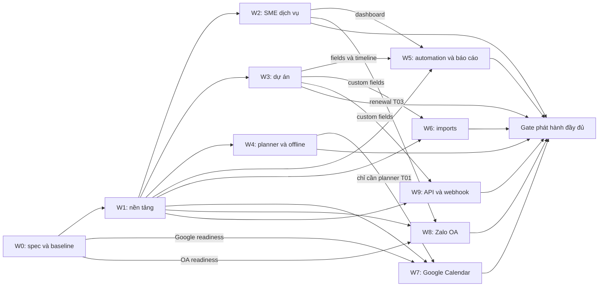

# Kế hoạch 10 wave và điều kiện nghiệm thu

Ngày lập: 2026-10-16. Tài liệu này phân chia **58 task** ở [backlog](07-tasks.md) thành 10 wave có đầu vào/đầu ra cụ thể. Đây là kế hoạch triển khai, không phải lịch cam kết hoặc trạng thái hoàn thành. Chưa gán sprint/ngày phát hành vì chưa có năng lực đội ngũ và kết quả baseline đủ để ước lượng có trách nhiệm.

[Tiến độ và bằng chứng thực thi](10-implementation-status.md) được ghi riêng; suite pass không tự mở gate browser, thiết bị hoặc provider. [Đối soát 10 checklist gate và chạy lại](test-cases/runs/2026-10-16-test-plan-review.md) lưu bằng chứng của snapshot hiện tại.

Định hướng ưu tiên: **SME dịch vụ/agency → quản lý dự án → cá nhân/freelancer**. Planner/offline vẫn được xây sau nền tảng vì đã là yêu cầu cốt lõi Web/Android và phục vụ trải nghiệm Google đồng hành. Các wave W2/W3/W4 có thể chạy song song, không phải đợi toàn bộ wave trước theo thứ tự số.

## Nguyên tắc triển khai

1. W0 ghi baseline và làm rõ hiện trạng; W1 xây quyền/dữ liệu/concurrency trước khi tích hợp hoặc thêm đường mutation.
2. Tối đa **3 luồng triển khai đồng thời + 1 điều phối/tích hợp**. Điều phối không tạo thêm một luồng sửa shared schema/router/types song song với người đang sở hữu chúng.
3. Một đầu mối tích hợp sở hữu migration numbering, shared types, router/business-service contracts và backup/restore format. Người làm feature đề xuất thay đổi và merge theo thứ tự dependency.
4. Tái sử dụng service, database, outbox và test harness hiện có; giữ single-worker deployment. Không thêm broker hoặc framework chỉ để chuẩn bị khả năng chưa cần.
5. Gate cần bằng chứng đúng lớp: unit/component/HTTP runtime không thay browser/thiết bị/provider thật; mock pass không mở gửi thật.
6. Mỗi wave chỉ phải đạt các ca xuyên suốt đã thuộc phạm vi wave đó. Wave sớm không bị chặn bởi tính năng wave tương lai chưa có.
7. Điều kiện Google/OA bên ngoài được theo dõi riêng ngay W0. Chưa sẵn sàng không cản tiến độ nội bộ độc lập; tích hợp thật vẫn bị chặn phát hành cho đến khi đủ bằng chứng.

## Tóm tắt wave

| Wave | Tasks | Đầu vào cứng | Đầu ra người dùng | Gate |
|---|---:|---|---|---|
| W0 | 6 | Không | Chức năng nền tảng dễ tìm, số liệu đúng, spec/baseline rõ | W0-T01–T04; T05/T06 có readiness record riêng |
| W1 | 11 | W0-T02/T04 và mô tả W0-T01 | Project/quyền/guest/ghế và mutation đáng tin cậy | W1-T11 |
| W2 | 5 | W1-T11 | Vận hành dịch vụ, nhắc gia hạn và lịch sử Web/Android | W2-T05 |
| W3 | 6 | W1-T11 | Custom fields/views/dependencies/timeline/templates | W3-T06 |
| W4 | 5 | W1-T11 | Planner và tạo/sửa task offline Android | W4-T05 |
| W5 | 6 | W1; W2-T01; W3-T01/T02/T04 | Lịch làm, automation, time/capacity/portfolio/SLA | W5-T06 |
| W6 | 5 | W1; W3-T01 | Di chuyển CSV/Trello an toàn trên Web/Android | W6-T05 |
| W7 | 5 | W1; W0-T05; W4-T01 | Google Calendar hai chiều có kiểm soát | W7-T05 thật |
| W8 | 4 | W1; W0-T06; W2-T03 | Zalo OA nhân sự/khách hàng theo doanh nghiệp | W8-T04 thật |
| W9 | 5 | W1; W3-T01; tất cả gate W2–W8 cho release đầy đủ | Public API/webhook và nghiệm thu toàn hệ thống | W9-T05 |

“W1” trong bảng dependency viết tắt cho gate W1-T11, trừ khi bảng chi tiết task cho phép chuẩn bị trên hợp đồng nền tảng đã merge. Dependency chính xác của từng task nằm ở [07-tasks.md](07-tasks.md); không suy W7 phải chờ toàn bộ offline W4 hoặc W8 phải chờ W7.

## W0 — Spec, baseline và sửa các điểm đang cản sử dụng

- **Tasks:** W0-T01 spec; T02 baseline; T03 expose UI hiện hữu/lịch sử nhắc; T04 sửa tiền/catalog/filter/ngày; T05 Google readiness; T06 Zalo readiness.
- **Trình tự:** T01/T02 có thể song song; T03/T04 sau T02; T05/T06 sau T01. Provider review không cần sửa feature trước.
- **Đầu ra:** đủ bộ spec, nguồn và decision log; báo cáo môi trường/test thực tế; người dùng thao tác được chức năng hiện có và nhìn đúng số liệu; manifest provider với điều kiện thiếu có chủ xử lý.
- **Gate nội bộ:** T01–T04 đạt acceptance tương ứng, test regressions cho phần đã sửa có bằng chứng. Không ghi whole W0 pass nếu T01 còn link/test/task thiếu.
- **Gate provider:** T05/T06 có thể kết thúc phần review bằng readiness record nêu chưa sẵn sàng; W7/W8 thật vẫn BLOCKED tương ứng. Review hoàn tất và provider ready là hai trạng thái khác nhau.
- **Kiểm thử:** catalog W0 và TC-X01/X03/X04/X05/X06/X12 phần hiện có. Baseline failures được ghi riêng, không tự đổi thành lỗi task mới hoặc bỏ qua vô thời hạn.

<!-- TEST-GATE-CHECKLIST -->
**Checklist nghiệm thu W0** (chưa đánh dấu đạt):

- [ ] Hoàn tất checklist từng task W0 trong [backlog](07-tasks.md) và mọi P0/P1 áp dụng theo [ma trận task–test–gate](test-cases/README.md#ma-trận-tasktestgate).
- [ ] Lưu expected/actual, commit hoặc snapshot, runtime/schema/fixture và bằng chứng đúng nền tảng; chạy concurrency/fault/regression liên quan. Source/component/mock không thay browser, thiết bị hoặc provider thật.
- [ ] Không còn FAIL/NOT RUN/BLOCKED bắt buộc của gate đang xét; ghi riêng điều kiện provider chưa đủ và phần nội bộ độc lập đã đạt. Ca của wave tương lai không chặn wave này.

## W1 — Project, quyền, dữ liệu và xử lý đồng thời

- **Tasks:** W1-T01 migration; T02 entitlement; T03 project/board/backfill; T04 ACL; T05 guests/seats; T06 UI; T07 structured events; T08 revisions; T09 receipts; T10 outbox; T11 gate.
- **Trình tự:** T01 và T02 song song → T03 → T04. Sau T04 tách hai nhánh: T05→T06 và T07→T08→T09→T10. T11 đợi cả hai nhánh và migration đầy đủ.
- **Đầu ra:** project có quyền riêng và guest đúng ghế; backend/client/worker dùng cùng entitlement/ACL; mutation có revision/idempotency; lịch sử và outbox bền vững; backup/restore hiểu thực thể mới.
- **Gate:** W1-T11 đủ permission matrix mọi surface, cạnh tranh ghế/receipt/recurrence/lease trên PostgreSQL độc lập, fault rollback và upgrade/restore rehearsal. Không chỉ thử happy path của UI.
- **Điểm chặn phát hành:** chưa có ACL xuyên search/AI/report/files/worker thì chưa mở guest/private project; chưa có receipt/revision đúng thì chưa bật queue offline hoặc inbound Google writes.
- **Kiểm thử:** toàn bộ W1 và TC-X01/X02/X03/X07/X11/X12 trong phạm vi nền tảng. Bản backup phục hồi giữ khóa hoặc báo thiếu khóa và chưa tự bật senders.

<!-- TEST-GATE-CHECKLIST -->
**Checklist nghiệm thu W1** (chưa đánh dấu đạt):

- [ ] Hoàn tất checklist từng task W1 trong [backlog](07-tasks.md) và mọi P0/P1 áp dụng theo [ma trận task–test–gate](test-cases/README.md#ma-trận-tasktestgate).
- [ ] Lưu expected/actual, commit hoặc snapshot, runtime/schema/fixture và bằng chứng đúng nền tảng; chạy concurrency/fault/regression liên quan. Source/component/mock không thay browser, thiết bị hoặc provider thật.
- [ ] Không còn FAIL/NOT RUN/BLOCKED bắt buộc của gate đang xét; ghi riêng điều kiện provider chưa đủ và phần nội bộ độc lập đã đạt. Ca của wave tương lai không chặn wave này.

## W2 — Giá trị vận hành SME trước

- **Tasks:** W2-T01 dashboard; T02 reminder policy; T03 renewal + optional expense; T04 Android parity; T05 SME gate.
- **Trình tự:** T01 và T02 song song; T03 sau T02; T04 sau T01/T03; T05 toàn luồng.
- **Đầu ra:** quản lý thấy việc quá hạn/chưa ack/đang hoãn; nhân sự chăm sóc và gia hạn dịch vụ trên Android; kỳ mới và nhắc đúng thời điểm; expense chỉ khi chọn.
- **Gate:** khách hàng→dịch vụ→task→ack/snooze→renewal→expense tùy chọn→kỳ tiếp theo; fixture báo cáo 5/6/2/2/1; cạnh tranh Web/Android không nhân kỳ/chi/nhắc; old service timing giữ hành vi.
- **Phát hành tăng dần:** có thể nghiệm thu/tung milestone SME nội bộ khi W1/W2 đạt; không quảng bá Google/Zalo/API chưa qua gate. Pilot chuẩn bị theo roadmap, không tự liên hệ khách hàng.
- **Kiểm thử:** W2, TC-X02/X04/X05/X06/X12; finance/renewal luôn online-only ở Android.

<!-- TEST-GATE-CHECKLIST -->
**Checklist nghiệm thu W2** (chưa đánh dấu đạt):

- [ ] Hoàn tất checklist từng task W2 trong [backlog](07-tasks.md) và mọi P0/P1 áp dụng theo [ma trận task–test–gate](test-cases/README.md#ma-trận-tasktestgate).
- [ ] Lưu expected/actual, commit hoặc snapshot, runtime/schema/fixture và bằng chứng đúng nền tảng; chạy concurrency/fault/regression liên quan. Source/component/mock không thay browser, thiết bị hoặc provider thật.
- [ ] Không còn FAIL/NOT RUN/BLOCKED bắt buộc của gate đang xét; ghi riêng điều kiện provider chưa đủ và phần nội bộ độc lập đã đạt. Ca của wave tương lai không chặn wave này.

## W3 — Project management hướng Trello/monday

- **Tasks:** W3-T01 custom fields; T02 views; T03 DAG dependencies; T04 timeline; T05 templates; T06 gate.
- **Trình tự:** T01/T03 song song; T02 sau T01; T04 sau T02/T03; T05 sau T01/T03; T06 đợi T02–T05.
- **Đầu ra:** thông tin dự án tùy biến, view lưu, nhìn dependency/timeline và tạo dự án từ template. Không thêm automatic scheduling hoặc workspace vô hạn tùy biến chỉ để chạy theo đối thủ.
- **Gate:** dữ liệu/filters/permissions nhất quán mọi view; DAG không cycle kể cả concurrent; template đúng IDs/relations; default dates không tự suy; mọi đường complete recurrence chỉ một successor; downgrade không mất custom data/private scope.
- **Kiểm thử:** W3, TC-X02/X03/X04/X05/X06/X07. Calendar view không được coi là Google connector.

<!-- TEST-GATE-CHECKLIST -->
**Checklist nghiệm thu W3** (chưa đánh dấu đạt):

- [ ] Hoàn tất checklist từng task W3 trong [backlog](07-tasks.md) và mọi P0/P1 áp dụng theo [ma trận task–test–gate](test-cases/README.md#ma-trận-tasktestgate).
- [ ] Lưu expected/actual, commit hoặc snapshot, runtime/schema/fixture và bằng chứng đúng nền tảng; chạy concurrency/fault/regression liên quan. Source/component/mock không thay browser, thiết bị hoặc provider thật.
- [ ] Không còn FAIL/NOT RUN/BLOCKED bắt buộc của gate đang xét; ghi riêng điều kiện provider chưa đủ và phần nội bộ độc lập đã đạt. Ca của wave tương lai không chặn wave này.

## W4 — Planner và Android offline ghi được

- **Tasks:** W4-T01 planner; T02 encrypted drafts/outbox; T03 replay/pending/temp IDs; T04 conflict/session/revocation/logout; T05 real-device gate.
- **Trình tự:** T01 và T02 có thể song song → T03 sau T02 → T04 → T05; T05 đợi cả planner.
- **Đầu ra:** Inbox/Today/Upcoming/Week Web/Android, nhập nhanh có preview; Android tạo/sửa task offline bền vững và trạng thái pending/sync/conflict rõ.
- **Gate:** APK thiết bị thật qua mất mạng/chuyển mạng/background/force-stop/reboot; không mất draft; một in-flight/resource; operation bất biến; TTL 24 giờ không vượt session/write eligibility; revoke cách ly queue đúng scope; recurrence không nhân kỳ.
- **Giới hạn được nghiệm thu:** Web không tự có offline writes; comment offline là draft; upload/delete/move/finance/renewal/permissions/integration/timer online-only. Không hứa nhận revoke tức thời khi thiết bị offline hoàn toàn hoặc sync nền khi force-stop.
- **Dependency cung cấp:** W4-T01 đủ mở W7-T02; W7 không phải đợi W4-T05. Test tích hợp Android offline + Google vẫn đợi cả hai khả năng tương ứng.
- **Kiểm thử:** W4, TC-X01/X04/X05/X06/X08/X09/X11 phần đã có; component tests không thay real device.

<!-- TEST-GATE-CHECKLIST -->
**Checklist nghiệm thu W4** (chưa đánh dấu đạt):

- [ ] Hoàn tất checklist từng task W4 trong [backlog](07-tasks.md) và mọi P0/P1 áp dụng theo [ma trận task–test–gate](test-cases/README.md#ma-trận-tasktestgate).
- [ ] Lưu expected/actual, commit hoặc snapshot, runtime/schema/fixture và bằng chứng đúng nền tảng; chạy concurrency/fault/regression liên quan. Source/component/mock không thay browser, thiết bị hoặc provider thật.
- [ ] Không còn FAIL/NOT RUN/BLOCKED bắt buộc của gate đang xét; ghi riêng điều kiện provider chưa đủ và phần nội bộ độc lập đã đạt. Ca của wave tương lai không chặn wave này.

## W5 — Lịch làm việc, automation và đo lường

- **Tasks:** W5-T01 calendars/delegates; T02 automation; T03 time tracking; T04 estimates/capacity/portfolio; T05 SLA; T06 gate.
- **Trình tự:** T01 sau W1; T03 sau W3-T02. T02 cần T01/W3-T01/outbox; T04 cần T01/T03/W3-T04 để capacity có lịch làm/ngày nghỉ; T05 cần T01/W2-T01/events. Ba nhánh hội tụ T06.
- **Đầu ra:** nhắc phù hợp giờ làm, delegate hợp lệ, rules sửa/nhân bản/scheduled; actual vs planned; capacity theo từng assignee và portfolio/SLA có nghĩa rõ.
- **Gate:** lịch làm opt-in không đổi legacy; delegate không cấp quyền; rule atomic/max10/loop guard/dedup; một active timer/user/workspace; unknown estimate không bằng 0; SLA không suy lịch sử trước rollout; tổng/export đối soát cùng dữ liệu.
- **Kiểm thử:** W5, TC-X02/X06/X07/X10/X12 phần hiện hữu. Report stale/error có trạng thái; không trình bày cache như dữ liệu mới.

<!-- TEST-GATE-CHECKLIST -->
**Checklist nghiệm thu W5** (chưa đánh dấu đạt):

- [ ] Hoàn tất checklist từng task W5 trong [backlog](07-tasks.md) và mọi P0/P1 áp dụng theo [ma trận task–test–gate](test-cases/README.md#ma-trận-tasktestgate).
- [ ] Lưu expected/actual, commit hoặc snapshot, runtime/schema/fixture và bằng chứng đúng nền tảng; chạy concurrency/fault/regression liên quan. Source/component/mock không thay browser, thiết bị hoặc provider thật.
- [ ] Không còn FAIL/NOT RUN/BLOCKED bắt buộc của gate đang xét; ghi riêng điều kiện provider chưa đủ và phần nội bộ độc lập đã đạt. Ca của wave tương lai không chặn wave này.

## W6 — Import và giảm chi phí chuyển đổi

- **Tasks:** W6-T01 CSV; T02 Trello; T03 preview/commit; T04 Web/Android UI; T05 gate.
- **Trình tự:** T01 sau W3-T01; T02 sau W1; parser/adapter có thể song song. T03 cần cả hai + receipt → T04 → T05.
- **Đầu ra:** khách đem dữ liệu CSV/Trello vào project, preview trước commit, mapping rõ và biết phần chưa hỗ trợ; nhập lại không nhân source task; JSON v1 giữ append.
- **Gate:** Unicode/quoted multiline/date/custom fields đúng; no implicit user creation; preview không side effect; commit nguyên tử/idempotent/recheck ACL; historical import không replay notification/automation; file limits/HTML/CSV formulas được kiểm soát.
- **Kiểm thử:** W6, TC-X02/X03/X04/X05/X07 và TC-X08 đầy đủ: import private project→offline edits→revoke→reconnect.

<!-- TEST-GATE-CHECKLIST -->
**Checklist nghiệm thu W6** (chưa đánh dấu đạt):

- [ ] Hoàn tất checklist từng task W6 trong [backlog](07-tasks.md) và mọi P0/P1 áp dụng theo [ma trận task–test–gate](test-cases/README.md#ma-trận-tasktestgate).
- [ ] Lưu expected/actual, commit hoặc snapshot, runtime/schema/fixture và bằng chứng đúng nền tảng; chạy concurrency/fault/regression liên quan. Source/component/mock không thay browser, thiết bị hoặc provider thật.
- [ ] Không còn FAIL/NOT RUN/BLOCKED bắt buộc của gate đang xét; ghi riêng điều kiện provider chưa đủ và phần nội bộ độc lập đã đạt. Ca của wave tương lai không chặn wave này.

## W7 — Đồng hành Google Calendar

- **Tasks:** W7-T01 consent/calendar/token; T02 outbound mapping; T03 inbound/watch/sync; T04 conflict/unlink/revoke UI; T05 account thật.
- **Trình tự:** T01 sau W1/readiness; T02 cần planner W4-T01/outbox; T03 cần revision/receipt; T04 → T05. Các bước connector tuần tự theo hợp đồng mapping.
- **Đầu ra:** người dùng tiếp tục xem/sửa lịch ở Google trong khi Nhắc Tôi giữ assignment/ack/renewal/audit và phân quyền nghiệp vụ.
- **Gate:** consent riêng; app-created scope đúng; personal plan/shared deadline/appointment/renewal có mapping khác nhau; shared deadline edits qua quyền/revision; delete không xóa task; recurrence không RRULE; sync paging/410/watch/echo/conflict phục hồi được; có tài khoản thật và provider IDs.
- **Điểm chặn:** thiếu consent verification/test account/quota giữ W7-T05 BLOCKED; không bật sync chỉ vì mock pass. Google Tasks UI trong Calendar không chứng minh connector Tasks; Tasks/date-only/booking vẫn discovery.
- **Kiểm thử:** W7, TC-X01/X02/X06/X09/X11/X12; TC-X09 chạy đầy đủ với Android offline và task lặp.

<!-- TEST-GATE-CHECKLIST -->
**Checklist nghiệm thu W7** (chưa đánh dấu đạt):

- [ ] Hoàn tất checklist từng task W7 trong [backlog](07-tasks.md) và mọi P0/P1 áp dụng theo [ma trận task–test–gate](test-cases/README.md#ma-trận-tasktestgate).
- [ ] Lưu expected/actual, commit hoặc snapshot, runtime/schema/fixture và bằng chứng đúng nền tảng; chạy concurrency/fault/regression liên quan. Source/component/mock không thay browser, thiết bị hoặc provider thật.
- [ ] Không còn FAIL/NOT RUN/BLOCKED bắt buộc của gate đang xét; ghi riêng điều kiện provider chưa đủ và phần nội bộ độc lập đã đạt. Ca của wave tương lai không chặn wave này.
- [ ] Có bằng chứng Google/OA thật được phép; thiếu account/template/quota/consent tiếp tục BLOCKED cho gate gửi/sync thật.

## W8 — Zalo OA doanh nghiệp

- **Tasks:** W8-T01 connection/registry; T02 purpose/template preview; T03 delivery/callback; T04 OA thật/history.
- **Trình tự:** T01 sau W1/OA readiness; T02 sau W2-T03; T03 sau outbox/T02; T04 cuối. Có thể bắt đầu khi W2 đạt, không phụ thuộc W7.
- **Đầu ra:** nhân sự và khách hàng nhận thông báo phù hợp từ OA của doanh nghiệp; quản trị biết template/recipient eligibility và trạng thái gửi.
- **Gate:** tenant isolation/encrypted secret/Business guard; template approved đúng mục đích/CTA; send-time ACL/kỳ/recipient check; timeout unknown được đối soát; callback authenticated/dedup; gửi thật cho nhóm được phép và lưu evidence.
- **Điểm chặn:** OA/mẫu/token/người nhận chưa hợp lệ chặn gửi thật. Không tự chuyển OA khác hoặc bỏ kiểm tra recipient để chạy demo. Accepted/delivered/read không thay ack công việc.
- **Kiểm thử:** W8, TC-X02/X03/X05/X10/X11/X12 phần đã có; toàn bộ downgrade có webhook sẽ hoàn tất tại W9.

<!-- TEST-GATE-CHECKLIST -->
**Checklist nghiệm thu W8** (chưa đánh dấu đạt):

- [ ] Hoàn tất checklist từng task W8 trong [backlog](07-tasks.md) và mọi P0/P1 áp dụng theo [ma trận task–test–gate](test-cases/README.md#ma-trận-tasktestgate).
- [ ] Lưu expected/actual, commit hoặc snapshot, runtime/schema/fixture và bằng chứng đúng nền tảng; chạy concurrency/fault/regression liên quan. Source/component/mock không thay browser, thiết bị hoặc provider thật.
- [ ] Không còn FAIL/NOT RUN/BLOCKED bắt buộc của gate đang xét; ghi riêng điều kiện provider chưa đủ và phần nội bộ độc lập đã đạt. Ca của wave tương lai không chặn wave này.
- [ ] Có bằng chứng Google/OA thật được phép; thiếu account/template/quota/consent tiếp tục BLOCKED cho gate gửi/sync thật.

## W9 — Public platform và phát hành toàn bộ

- **Tasks:** W9-T01 token; T02 API; T03 webhook; T04 OpenAPI/consumer/contract; T05 full release gate.
- **Trình tự:** T01 sau W1; T02 cần W3-T01; T03 cần outbox; T02/T03 song song → T04. T05 đợi T04 và tất cả gate W2–W8.
- **Đầu ra:** khách Business tích hợp task/project/custom fields bằng token scope; nhận webhook có chữ ký và event ID; tài liệu/ví dụ executable; hồ sơ phát hành toàn hệ thống.
- **Gate:** permission intersection/scoped tokens/revoke; cùng pipeline mutation; API pagination/limits/error contract; SSRF protections tại connect/redirect; raw-byte signature/rotation; consumer dedup; migration/restore; mọi P0/P1 bắt buộc có đúng lớp bằng chứng.
- **Release đầy đủ:** W9-T05 không đạt khi W7/W8 thật còn BLOCKED hoặc offline device chưa thử. Có thể phát hành milestone nội bộ đã đạt riêng, nhưng phải ghi rõ phạm vi và giữ connector/sender chưa đạt bị tắt.
- **Kiểm thử:** W9 và TC-X01–TC-X12 đầy đủ, đặc biệt import+offline+ACL, Google+recurrence, downgrade với queue và disaster recovery.

<!-- TEST-GATE-CHECKLIST -->
**Checklist nghiệm thu W9** (chưa đánh dấu đạt):

- [ ] Hoàn tất checklist từng task W9 trong [backlog](07-tasks.md) và mọi P0/P1 áp dụng theo [ma trận task–test–gate](test-cases/README.md#ma-trận-tasktestgate).
- [ ] Lưu expected/actual, commit hoặc snapshot, runtime/schema/fixture và bằng chứng đúng nền tảng; chạy concurrency/fault/regression liên quan. Source/component/mock không thay browser, thiết bị hoặc provider thật.
- [ ] Không còn FAIL/NOT RUN/BLOCKED bắt buộc của gate đang xét; ghi riêng điều kiện provider chưa đủ và phần nội bộ độc lập đã đạt. Ca của wave tương lai không chặn wave này.

## Điều phối ba luồng triển khai

Đây là phân bổ năng lực đề xuất theo dependency, không phải ba branch dài sống độc lập. Chỉ lấy task tiếp theo khi đầu vào thật đã sẵn sàng; merge nhỏ và cập nhật shared contracts trước khi agent khác phụ thuộc.

| Giai đoạn | Luồng A | Luồng B | Luồng C | Điều phối/tích hợp |
|---|---|---|---|---|
| Nền tảng | W0-T01/T03; sau đó W1 project/ACL | W0-T02/T04; sau đó migration/entitlement | W0-T05/T06 readiness; sau đó test fixtures/UI foundation | Giữ baseline, thứ tự migrations, quyết định contract, gate W0/W1 |
| Sau W1 | W2 SME | W3 projects | W4 planner/offline | Review ACL/events/receipt, tích hợp Web/Android |
| Mở rộng | W5 theo dependency | W6 sau custom fields | W7 sau planner; W8 khi slot trống và OA ready | Không quá ba người sửa feature; ưu tiên critical path và provider availability |
| Public/release | W9-T01/T02 API | W9-T03 webhook | Thiết bị/provider gates và lỗi tích hợp còn lại | W9-T04 contract, TC-X, migration/restore và release manifest |

Nếu một luồng bị provider blocked, chuyển sang task nội bộ độc lập đã đủ dependency; không giảm tiêu chuẩn gate hoặc tự đánh dấu provider ready. Không chạy W5/W6/W7/W8/W9 tất cả cùng lúc vượt ba luồng. Chủ schema/router có thể tạm giữ merge feature để bảo toàn migration order và version compatibility.

## Gate, rollback và bằng chứng

- Mỗi task/wave ghi trạng thái công việc riêng với test result. `NOT RUN`, `FAIL`, `BLOCKED`, `PASS` là kết quả từng case/biến thể, không là cảm nhận hoàn thành feature.
- Gate cần mọi P0/P1 bắt buộc đạt, gồm success/invalid input/direct API permissions/concurrency/failure/retry phù hợp. Review provider/document không cần unit test hình thức.
- Baseline failures, scope chưa triển khai và provider unavailable được báo tách biệt. Không thay số lượng test pass/code coverage cho coverage requirement hoặc bằng chứng E2E thật.
- Trước migration production: backup có manifest, restore rehearsal, phiên bản schema/application tương thích và thao tác bật sender có kiểm soát. Không giả định downgrade binary có thể đọc schema mới; rollback theo migration/recovery runbook đã kiểm chứng.
- Rollout từng khả năng cần entitlement + feature/sender control được ghi trong release manifest. Khi tắt integration giữ dữ liệu/receipt/history; không xóa private project hoặc queue mã hóa để che lỗi.
- Sau sự cố hoặc thay đổi quyền/mutation protocol, chạy lại các ca bị ảnh hưởng và cross-wave scenarios; không tự reuse bằng chứng của build không tương thích.
- Không đổi giá, số ghế hoặc quota AI/storage/automation thương mại trong quá trình triển khai các wave này. Discovery/pricing đề xuất chỉ thay scope khi có quyết định mới được ghi nhận.

## Mốc đo giá trị và discovery

Sau W2 có thể đo vận hành SME: thời gian đuổi việc, số việc quá hạn/chưa ack, số kỳ gia hạn bỏ lỡ và tỷ lệ thao tác thành công trên Android. Sau W6/W7 có thể đo chi phí chuyển dữ liệu, tỷ lệ liên kết Google và mức độ trùng thông báo. Sau W8 đo gửi phù hợp/unknown/retry và thời gian xử lý gia hạn; provider delivered không được dùng thay kết quả nghiệp vụ.

Pilot đề xuất 5–8 doanh nghiệp đã dùng Google trong khoảng một tháng, kiểm chứng khả năng trả tiền thật thay vì chỉ hỏi thích tính năng. D01 Google Tasks, D02 date-only deadline, D03 booking, D04 pilot và D05 reprioritization giữ ngoài 58 task. Chuẩn bị kịch bản và đo lường không phải ủy quyền liên hệ khách hàng tự động. Chi tiết giá trị/giả thuyết nằm ở [roadmap và validation](06-roadmap-and-validation.md).
